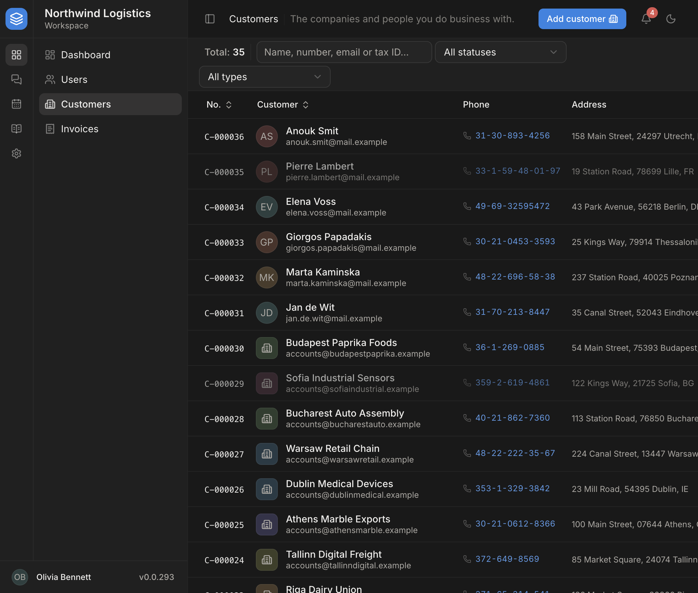
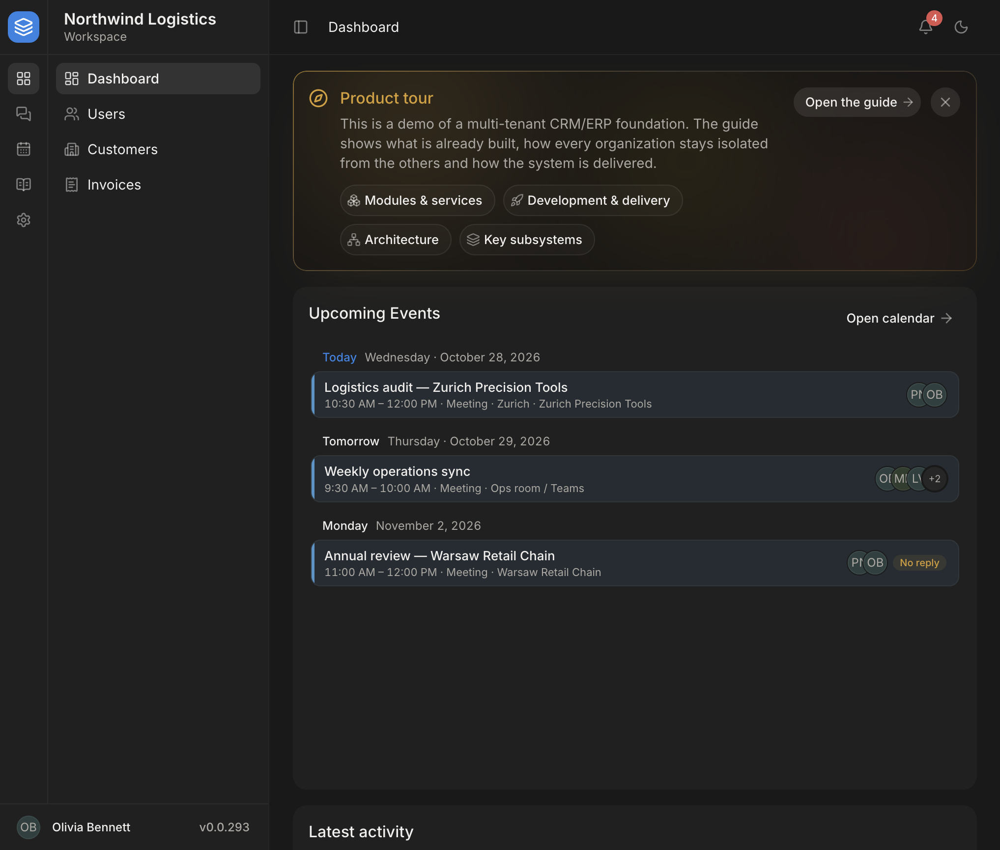
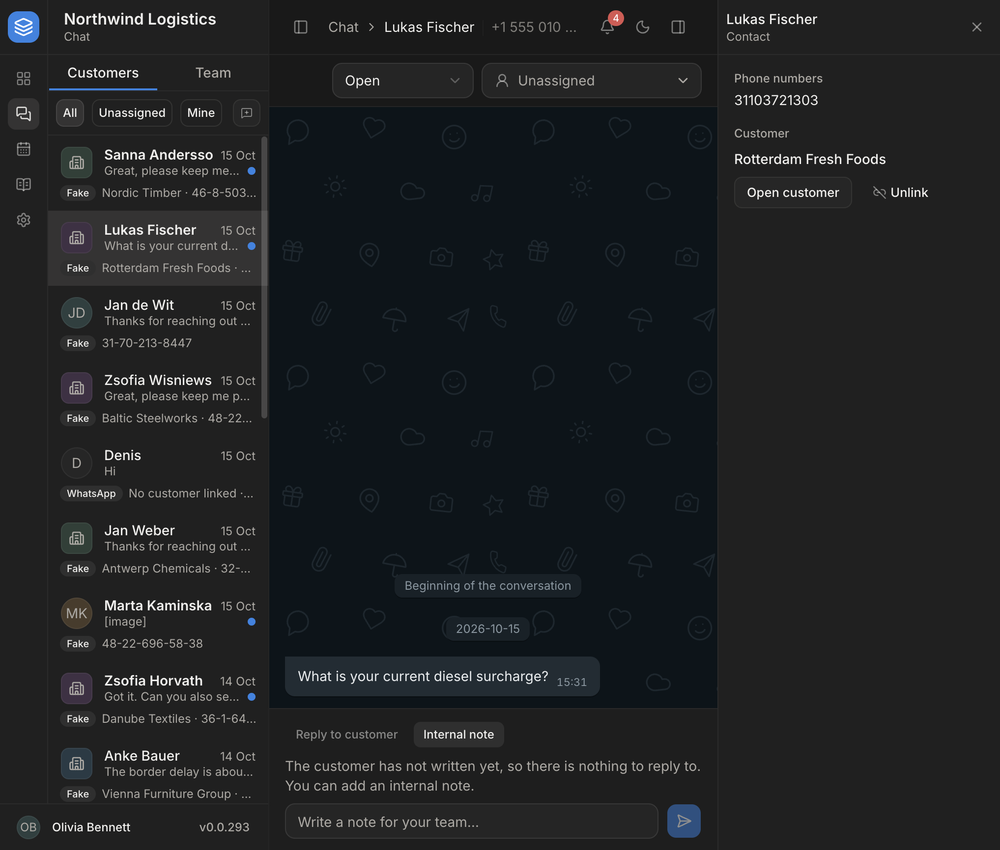
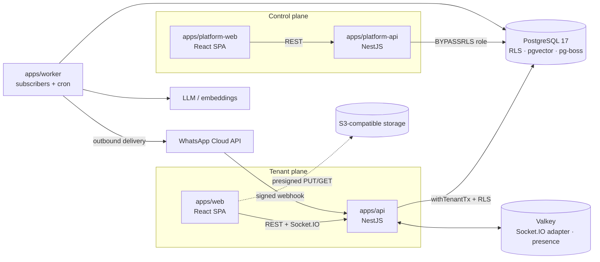

<div align="center">

# Tenantry

**A production-shaped foundation for multitenant CRM/ERP SaaS products.**

Two planes (tenant app + operator control plane), Postgres row-level security as the tenant
boundary, end-to-end typed contracts, a transactional-outbox message bus, realtime, an AI
assistant with grounded citations, and a WhatsApp customer channel — built as a forkable base
rather than a demo.

[**Live demo**](https://web.2-29-1-13.sslip.io) ·
[Control plane](https://platform.2-29-1-13.sslip.io) ·
[Architecture](docs/multi-tenancy-architecture.md) ·
[Conventions](docs/backend-conventions.md) ·
[Roadmap](docs/roadmap.md)


</div>



## Try it

The demo runs on a single Hetzner VPS and is seeded with three industry tenants
(logistics, healthcare, creative studio). The sign-in page lists the demo accounts, so you can
sign in with one click; all of them use the `.example` TLD, and no email is ever sent.

| Surface | URL | Account |
| --- | --- | --- |
| Tenant app | https://web.2-29-1-13.sslip.io | any chip under **Demo accounts** (e.g. `olivia.bennett@northwind.example` / `Demo12345678`) |
| Control plane | https://platform.2-29-1-13.sslip.io | `platform@example.com` / `Platform12345` |

The demo data can be reset at any time. The AI assistant is live but limited to a few questions per user per day.

## What's inside

| Area | What is built |
| --- | --- |
| **Multitenancy** | Shared schema with `tenant_id` and **Postgres RLS as the primary enforcement**: the app connects as a non-owner role, and every request runs inside a transaction that sets the tenant via `set_config`. Domain code never passes a `tenantId`. |
| **Two planes** | Tenant API + SPA and a separate control plane (operator API + SPA) with its own identity, JWT secret, cookie and database role. |
| **Auth** | Custom implementation: short-lived access JWT in memory, a rotating refresh token in an httpOnly cookie, sessions as a first-class entity (device list, idle and absolute expiry, reuse detection), password recovery and email change through single-use tokens, rate limiting. |
| **Typed contracts** | Zod 4 schemas → `nestjs-zod` DTOs → OpenAPI → orval → TanStack Query hooks. There are no hand-written API types; generated artifacts are committed. |
| **Messaging** | Events and commands over a transactional outbox on pg-boss: `publish(tx, …)` fans out inside the producing transaction, idempotency is keyed by message and consumer, poison messages go to a DLQ. Topology mismatches fail at worker boot. |
| **Realtime** | Socket.IO + Valkey (Redis Streams adapter), presence leases, last-seen. Socket events say "re-read"; the few that carry payloads use monotonic counters with a REST resync. |
| **Domain modules** | Customers (organisations and people, human-readable per-tenant numbering), calendar (attendees, RSVP, time zones, reminders), activity feed, notification inbox, files (presigned two-phase S3 upload with magic-byte verification), org and personal settings. |
| **Chat** | Internal team conversations plus a provider-neutral customer channel: signed webhook → raw event store → ingest, ordered outbound delivery, delivery receipts, assignment workflow. WhatsApp Cloud API is the first adapter. |
| **AI assistant** | Streaming answers generated only in the worker. Hybrid retrieval (pgvector + Postgres full-text search, merged by RRF), citations verified on the server and re-authorized on every open, per-user quotas, a cost ledger, and an offline answer-quality eval harness. |
| **Module graph** | Apps and libs are split into tiers (infra → platform → core → feature) declared in [`modules.config.ts`](modules.config.ts). Lint fails on an undeclared or upward import and on any runtime import cycle; lower modules expose slots that features fill. |
| **Delivery** | Docker images, a GitLab CI → Docker Swarm pipeline, and a GitHub Actions → Hetzner pipeline (self-hosted runner, Caddy TLS). Per-worktree isolated dev stacks for parallel agent work. |

<table>
  <tr>
    <td></td>
    <td></td>
  </tr>
  <tr>
    <td align="center">Dashboard with product tour</td>
    <td align="center">Customer chat with linked record</td>
  </tr>
</table>

## Architecture



| Path | Role |
| --- | --- |
| `apps/api` | Tenant API: auth, account, users, customers, calendar, chat, files, activities, notifications, realtime gateway, AI |
| `apps/platform-api` | Control plane: operator auth, tenants, job monitoring, AI settings and cost ledger |
| `apps/worker` | No HTTP: message subscribers, cron, email, AI reply generation |
| `apps/web`, `apps/platform-web` | SPAs with a two-level navigation shell, code grouped by feature module |
| `libs/contracts` | Zod schemas, the single source of API types |
| `libs/database` | Prisma schema (one file per module), migrations, seeds, tenant context and transactions |
| `libs/shared` | Messaging runtime, recorders, storage, channels, AI pipeline |
| `libs/ui` | Shared shadcn/ui (Base UI) primitives, theme, data grid, forms |

## Engineering practices

- **Invariants ship with tests.** 54 e2e suites run against real Postgres and Valkey; the ones guarding
  concurrency use `Promise.all` races, negative cases or redelivery, not just the happy path.
- **Read-modify-write is guarded**: conditional `updateMany`, atomic increments, unique indexes or
  `SELECT … FOR UPDATE`, and the top-level method owns the single transaction.
- **Errors have one envelope** (`ApiError` with a stable `code`); backend messages are diagnostics, and the
  frontend renders codes through i18next.
- **Decisions are written down.** [`docs/`](docs) holds the reasoning for every subsystem,
  [`openspec/`](openspec) holds behavioural specs and in-flight changes, and [`AGENTS.md`](AGENTS.md) is the
  working agreement for AI coding agents (Claude Code, Codex) that helped build the project.
- **One local gate**: `pnpm verify` runs lint (ESLint strict-type-checked, module graph, import cycles),
  typecheck, unit tests and both e2e suites in throwaway containers.

## Run locally

Requirements: Node 24+, pnpm 10, Docker.

```bash
cp .env.example .env
pnpm install
pnpm docker:up          # Postgres 17 (pgvector) + Valkey + Mailpit + SeaweedFS
pnpm db:generate && pnpm db:migrate:dev && pnpm db:seed
pnpm db:seed:demo       # optional: the three demo tenants

pnpm api:dev            # http://localhost:3001  (Swagger at /api/docs)
pnpm worker:dev
pnpm web:dev            # http://localhost:5173
pnpm platform:dev       # http://localhost:3002
pnpm platform:web:dev   # http://localhost:5174
```

Default accounts: `admin@example.com` / `Admin1234567` (tenant) and `platform@example.com` /
`Platform12345` (control plane). Every command is documented in [docs/commands.md](docs/commands.md).

## Documentation

Most design documents are written in Ukrainian.

| Topic | Document |
| --- | --- |
| Multitenancy, RLS, both planes | [multi-tenancy-architecture.md](docs/multi-tenancy-architecture.md) |
| Backend rules and their reference code | [backend-conventions.md](docs/backend-conventions.md) |
| Module tiers and the dependency graph | [modules.md](docs/modules.md) |
| Messaging, DLQ | [event-driven-architecture.md](docs/event-driven-architecture.md) |
| Realtime | [realtime.md](docs/realtime.md) |
| Auth and sessions | [auth-hardening-plan.md](docs/auth-hardening-plan.md) |
| Chat and the WhatsApp channel | [chat.md](docs/chat.md), [whatsapp-channel.md](docs/whatsapp-channel.md) |
| AI assistant | [ai-assistant.md](docs/ai-assistant.md), [ai-assistant-implementation.md](docs/ai-assistant-implementation.md) |
| Frontend stack and UI conventions | [frontend/ui-stack.md](docs/frontend/ui-stack.md) |
| Deployment | [deploy-hetzner.md](docs/deploy-hetzner.md), [deploy-swarm.md](docs/deploy-swarm.md) |
| What's next | [roadmap.md](docs/roadmap.md) |

## Status

Under active development since July 2026. Not built yet: 2FA, permission-based RBAC, subdomain routing
and billing. The roadmap lists priorities and phase status.

## License

[MIT](LICENSE)
