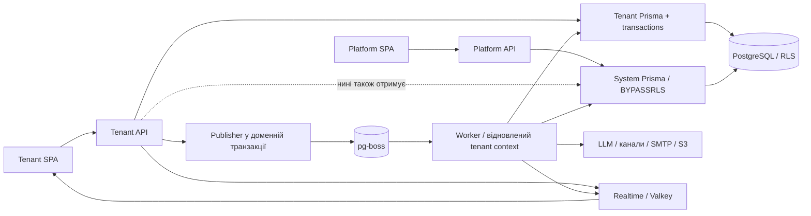

# Архітектурний огляд — 2026-10-15

База огляду: `f675b43`, робоче дерево перед оглядом чисте. Методика:
`architecture-review` (`ruicore/codex-skills`), встановлений локально.
Режим: аналіз без зміни поведінки застосунку. Цей звіт — результат огляду,
а не нова нормативна архітектура і не затверджений план реалізації.

## Висновок

Поточна форма — модульний моноліт у монорепозиторії з двома HTTP/SPA-площинами
та окремим worker — відповідає задачі forkable CRM/ERP. У перевірених шляхах
є реальні механізми меж: RLS, транзакційний publisher, спільні переходи станів,
контракти, хуки й слоти. Підстав для переходу на мікросервіси, загальний CQRS
чи repository-шар поверх Prisma цей огляд не виявив.

Головний розрив — життєвий цикл identity не керує всім приватним станом браузера.
Другий — tenant API отримує привілейований DB-клієнт, хоча його звичайні сценарії
працюють під RLS. Третій — нормативні документи суперечать актуальній auth-моделі.

Підтверджено **2 P1 та 1 P2**. P0 у перевіреному обсязі не виявлено; це не
сертифікація безпеки. Найменше корисне виправлення — централізувати завершення
клієнтської сесії з очищенням даних попередньої identity.

## Обсяг і докази

Прочитані composition roots усіх backend-процесів і tenant SPA, граф модулів,
ESLint-обмеження, tenant Prisma extension/transactions, system-клієнт, auth guards
та socket auth, користувацькі й операторські сценарії керування користувачами,
settings/bootstrap/numbering, files, lifecycle hooks, messaging publisher/inbox/registrar.
Вибірково простежені chat access, customer replies, channel delivery/status/contact,
AI availability/state/citation/generation та frontend auth/cache/realtime.

Зіставлено `docs/modules.md`, backend conventions, multi-tenancy, auth hardening,
account settings, file storage, chat, AI implementation/plans/platform controls,
UI stack/app shell; прочитані релевантні частини тестів ізоляції та messaging.
Документи й коментарі використовувалися як гіпотези, які звірялися з кодом.

Виконано:

- `pnpm modules:check --strict` — без порушень.
- `pnpm deps:check` — 492 файли, циклів не знайдено; інструмент також повідомив
  один warning. Це результат у межах резолюції madge, не доказ відсутності всіх
  семантичних або runtime-залежностей.
- Локальний експеримент із реальними Zustand store і TanStack Query — відтворив
  збереження кеша попередньої identity (A1 нижче).

Не запускалися DB/e2e, браузерний сценарій, навантаження або зовнішні API.
Не перевірялися повністю всі запити, конкурентні виконання й міграції: це предмет
окремого `database-access-audit`. Бізнесовий код та конфігурація не змінювалися.

## Архітектурна карта



| Поняття                        | Авторитетний власник / межа                                                              | Шлях майбутньої зміни                                                                          |
| ------------------------------ | ---------------------------------------------------------------------------------------- | ---------------------------------------------------------------------------------------------- |
| Tenant-контекст та ізоляція    | `libs/database/src/tenant`, SQL RLS; HTTP guard і worker registrar встановлюють контекст | middleware/extension/transactions → isolation tests; домени не додають власні tenant-фільтри   |
| Залежності доменів             | `modules.config.ts`, `docs/modules.md`                                                   | owner paths/dependsOn → imports → `modules:check`; окремо перевірити Prisma та рядкові зв’язки |
| API-форма                      | Zod у `libs/contracts`, DTO/mapper власника                                              | schema → OpenAPI → orval → споживачі обох відповідних шарів                                    |
| Сесія людини                   | auth/account/users; окрема identity платформи                                            | login/refresh/revoke → transport → браузерний стан; остання ланка зараз неповна                |
| Синхронний інваріант створення | lifecycle hook нижнього модуля; реалізація у фічі                                        | `UserLifecycleHooks`/`TenantLifecycleHooks` → chat provisioner; одна транзакція                |
| Надійний асинхронний наслідок  | messaging definitions + topology + publisher/inbox                                       | definition → topology → subscriber; помилка wiring зупиняє worker                              |
| Клієнтська розмова             | chat, `ConversationWorkflow`, channel delivery/status                                    | access → workflow → атомарний запис/job → provider adapter → receipt                           |
| AI-відповідь                   | API приймає запит, shared state визначає переходи, worker генерує                        | availability/quota → reply state → generation → citations; LLM не викликається з API           |
| UI-розширення                  | модуль оголошує slot/menu, фіча заповнює через composition root                          | feature routes/nav/fills; нижній модуль не імпортує фічу                                       |

`libs/shared` тут — місце спільного виконання, а не один бізнесовий модуль.
`shared/ai` і `shared/chat` мають доменних власників у графі. Сам факт наявності
бізнесового коду в shared не є порушенням.

## Основні знахідки

| ID / пріоритет | Місце                                                                                                         | Проблема та архітектурна причина                                                                                | Найменша корисна дія                                                                                                                   | Ризик без зміни                                                                                           |
| -------------- | ------------------------------------------------------------------------------------------------------------- | --------------------------------------------------------------------------------------------------------------- | -------------------------------------------------------------------------------------------------------------------------------------- | --------------------------------------------------------------------------------------------------------- |
| A1 / P1        | `apps/web/src/main.tsx:36`, `features/auth/stores/auth.store.ts:32`, `app-shell/account-footer.tsx:69`        | Сесія завершується, але приватний кеш і feature stores продовжують жити. Межа identity не охоплює весь стан SPA | Один session lifecycle у composition root: зупинення старих запитів, очищення кеша/приватних stores, захист від запізнілих результатів | Інший користувач/тенант у тій самій вкладці може отримати попередні дані з пам’яті                        |
| A2 / P1        | `libs/database/src/prisma.module.ts:29`, `system-prisma.service.ts:30`, `docker/docker-compose.stack.yml:200` | Глобальний tenant PrismaModule також провайдить BYPASSRLS-клієнт; tenant API має зайві повноваження             | Розділити підключення tenant/system; system явно імпортують лише platform/worker; відокремити runtime secrets від migration job        | Помилкова інжекція обходить RLS, не порушуючи поточний граф; зайва залежність API від platform DB-доступу |
| A3 / P2        | `docs/multi-tenancy-architecture.md:288`, `docs/frontend/app-shell.md:751`                                    | Кілька документів подають різні чинні auth-протоколи                                                            | Одне нормативне джерело auth; в інших документах посилання й актуальні короткі відмінності                                             | Наступна зміна може відновити скасовану модель або спиратися на неіснуючу гарантію                        |

### A1. Приватний клієнтський стан не належить життєвому циклу сесії

**Ланцюг доказів.** `QueryClient` створюється один раз у `apps/web/src/main.tsx`.
Logout у `account-footer.tsx` викликає API, `clearSession()` і SPA-navigation,
не перезавантажуючи документ. `clearSession()` скидає тільки user/token.
Login встановлює наступну сесію й також виконує SPA-navigation.
Згенеровані ключі `getCustomersFindAllQueryKey` та `getSettingsBootstrapQueryKey`
містять URL/параметри, але не identity. Bootstrap у `AppNavProvider` має
`staleTime: Infinity`; загальний дефолт запитів — 30 секунд.

Пошук у runtime-коді обох SPA не знайшов `queryClient.clear`, `removeQueries`,
`cancelQueries` чи загального auth-підписника для очищення даних. Наявний
auth-підписник у `features/realtime/socket.ts` керує з’єднанням, не кешем.
Chat outbox у `features/chat/stores/chat-outbox.store.ts` також живе поза auth-store
і не має reset-операції. У platform-web такий самий структурний розрив між
QueryClient і logout; повний користувацький сценарій там окремо не відтворювався.

**Перевірка контраргументів.** RLS захищає новий запит до сервера, але не дані,
які браузер уже отримав. Refetch/reconnect-invalidation не видаляє попередній
результат і не покриває весь кеш. Повне оновлення сторінки очистило б пам’ять,
але звичайний logout/login його не робить. Це не твердження про читання чужої БД
новим JWT: проблема — повторне використання вже завантаженого клієнтського стану.

**Локальне відтворення.** Node із cwd `apps/web`, реальні імпорти
`@tanstack/react-query` і `./src/features/auth/stores/auth.store.ts`:

```js
const client = new QueryClient();
const key = ['/api/settings/bootstrap'];
useAuthStore.getState().setSession({ id: 'user-A' }, { accessToken: 'token-A' });
client.setQueryData(key, { organization: { name: 'Tenant A' } });
useAuthStore.getState().clearSession();
useAuthStore.getState().setSession({ id: 'user-B' }, { accessToken: 'token-B' });
let fetched = false;
const result = await client.fetchQuery({
  queryKey: key,
  staleTime: Infinity,
  queryFn: async () => {
    fetched = true;
    return { organization: { name: 'Tenant B' } };
  },
});
// Перевірені assertions: result.organization.name === 'Tenant A'; fetched === false.
```

Вивід: `{"currentUser":"user-B","returnedOrganization":"Tenant A","networkFetch":false}`.
Identity-об’єкти тут мінімальні синтетичні JS-fixtures, не справжні login-response.
Експеримент підтверджує механіку кеша; видимий UI-витік ще потребує browser regression.

**Рішення.** Власник — auth lifecycle, wiring — composition root. Очищення має
спрацьовувати на logout, втрату сесії та зміну identity, але не на звичайний refresh.
Скасувати старі запити й не дозволити їхнім запізнілим відповідям або mutation callbacks
повернути старі дані. Feature stores надають локальне очищення; auth не імпортує chat/AI.
Для мінімального першого виправлення можна розглянути повне перезавантаження документа
на завершенні сесії, перевіривши серверний logout та незавершений refresh.

**Впевненість:** висока щодо механіки й відсутньої межі; browser impact перевірити окремо.

### A2. Привілейований DB-клієнт доступний tenant API

**Ланцюг доказів.** Tenant `AppModule` імпортує глобальний `PrismaModule`.
Останній реєструє й експортує одночасно tenant client, `PRISMA_BASE` та
`SystemPrismaService`. System-клієнт використовує `PLATFORM_DATABASE_URL`
і викликає `$connect()` у `onModuleInit`. Swarm API успадковує `db-env` із
platform і migration URL; entrypoint також виконує міграції до запуску API.

У поточному `apps/api/src` не знайдено прямої інжекції `SystemPrismaService`:
це **підтверджена зайва привілейована можливість**, а не знайдений HTTP-експлойт.
ESLint забороняє голий `$transaction`, але не цей імпорт; `modules:check`
дозволяє залежність від database/infra. Отже, коментар «лише системний код»
не забезпечений ні DI-межею, ні імпортним правилом.

**Перевірка контраргументів.** Worker справді потребує system-клієнта для cron;
platform — для операторських дій. Tenant e2e використовують `app.get(SystemPrismaService)`
для fixtures. Це пояснює нинішнє wiring, але не потребу публічного API у такому клієнті.
Webhook resolver використовує `PRISMA_BASE` під app-роллю й вузькі SECURITY DEFINER
функції — його не слід плутати з BYPASSRLS або прибирати разом із system provider.

**Рішення.** Прибрати system provider із tenant `PrismaModule`, явно підключити
наявний `SystemPrismaModule` у worker/platform, fixture-клієнт створювати тестовим
harness. Додати імпортне обмеження для tenant API. Окремим кроком винести міграції
з runtime entrypoint і обмежити credentials процесів. Просте видалення env-поля
недостатнє: сервіс має fallback, а deploy-шаблон містить відомі role credentials.
Для справжнього розділення повноважень потрібні окремі секрети й коректні grants.

**Впевненість:** висока для source/wiring/Swarm-конфігурації. Фактичні секрети,
активні DB-ролі й конфігурація живого стенда не перевірялися.

### A3. Документація auth має конкуруючі джерела поточної істини

`docs/multi-tenancy-architecture.md` §7 описує platform access 60m і відсутність
refresh. `docs/frontend/app-shell.md` §9.3–9.4 стверджує, що platform logout endpoint
не існує, токен у localStorage, refresh відсутній. Код уже інший:
`platform-auth.module.ts` задає дефолт 15m; `platform-auth.controller.ts` має
refresh/logout із cookie; platform auth-store тримає access лише в пам’яті;
футер викликає `platformAuthLogout`.

Додатково `docs/account-settings.md:60` називає `isActive: false` миттєвим
kill-switch, хоча перелічує тільки login/refresh/handshake. HTTP `JwtAuthGuard`
не перевіряє активність у БД. `docs/auth-hardening-plan.md` водночас явно приймає
затримку REST-revoke до закінчення JWT. Слід точно розрізнити новий login,
refresh, чинний REST JWT, поточний socket і керування з platform API.

**Контраргумент:** частина тексту виникла в MVP. Однак ці розділи не марковані
архівними, а AGENTS скеровує до документів як до чинних references. Тому це
архітектурний drift нормативних джерел, а не просто стара нотатка.

**Рішення.** Auth-hardening doc лишити канонічним для чинного протоколу;
інші документи повинні посилатися на нього, описуючи лише свої межі. Додати
коротку таблицю «дія → REST → існуючий WS → новий handshake → refresh».
Це не рекомендація автоматично вводити denylist: чинний stateless-компроміс
задокументований і потребує окремого продуктового рішення для зміни.

## Перевірені сильні сторони й відхилені підозри

- **Межі модулів діють.** Граф резолвить іменовані імпорти крізь barrels.
  Прийняті platform-цикли доменного графа не тотожні циклам runtime-імпортів.
- **Синхронний hook і async event мають різні ролі.** Default chat membership
  створюється в транзакції користувача/тенанта; welcome email — через publisher.
  Це виправдані два механізми, не дубль одного event bus.
- **Messaging має явні гарантії.** `publish(tx, ...)` вставляє jobs атомарно;
  `runOnce` комітить marker разом із ефектами. Registrar звіряє topology з handlers.
  Inbox не гарантує exactly-once зовнішнього SMTP/HTTP, і документація це розрізняє.
- **Chat API/worker поділяють правила, не транспорти.** `ConversationWorkflow`
  об’єднує зміни статусу/призначення; delivery робить claim → зовнішній send → settle;
  receipt folding має окремого власника. Повторна перевірка каналу у worker потрібна,
  бо між постановкою й виконанням минає час.
- **AI має обґрунтовані межі.** Shared state обслуговує API/worker; LLM module
  підключений worker-ом. Citation read знову читає роль користувача і перевіряє
  доступ до знань. Розміщення цих частин у різних процесах не є дублюванням домену.
- **UI slots і route composition доречні.** Shell не повинен знати конкретну AI-панель,
  а customer-модуль — імпортувати calendar задля картки найближчих подій.
- **Прямий Prisma і централізований error filter — чинний вибір.** Skill не є
  підставою вводити repositories лише для приховування ORM у кожному CRUD-сервісі.

## Відомий борг та умови повернення

| Пункт                                             | Чому не нова знахідка                                                                                   | Коли переглядати                                                                                                            |
| ------------------------------------------------- | ------------------------------------------------------------------------------------------------------- | --------------------------------------------------------------------------------------------------------------------------- |
| Calendar read-modify-write до транзакції          | Явно в `docs/backend-conventions.md` §4; цей огляд не перевіряв усі конкурентні результати              | Окремий DB-аудит; перед розширенням учасників/нагадувань                                                                    |
| Numbering mutation й activity у двох транзакціях  | `numbering.controller.ts` прямо фіксує прийняту можливість втрати audit-запису                          | До фінансових документів або вимоги повного аудиту; orchestration може передавати один `tx`, не додаючи activities у двигун |
| `aiAllowed` у tenants                             | Прийнятий виняток `docs/modules.md` §7.5                                                                | Друга фіча з per-tenant entitlement                                                                                         |
| Центральний список number series                  | Прийнятий виняток із одним споживачем                                                                   | 3+ серії, як зафіксовано в docs                                                                                             |
| Окремі shell двох SPA                             | Прийняте розділення різних продуктів; shared navigation уже винесена                                    | Третій споживач або доведене повторення однакових змін                                                                      |
| Record-level file ACL                             | Поточний download перевіряє tenant/RLS і READY; doc відкладає RBAC, поточний видимий споживач — аватари | Перед приватними вкладеннями чату/документів: успадкувати доступ від owner-сутності, не вважати знання fileId дозволом      |
| REST-revoke до expiry, platform не рве WS негайно | Явно прийнято в auth hardening і multi-tenancy §7.1                                                     | Вимога негайного відкликання; спершу формалізувати гарантії                                                                 |

## Поверхня змін і порядок дій

**Крок 1 — A1, браузерна межа identity.** Власник: auth/app composition обох SPA.
Зачіпає session transitions, QueryClient, приватні feature stores, in-flight
HTTP/refresh. Згенерований клієнт не правити вручну. Перевірити A→logout→B
для одного tenant-а і різних tenant-ів, приватний чат, bootstrap, затриману відповідь
старого запиту та незавершений refresh. Звичайний refresh не повинен очищати UI.
Без міграцій БД; rollback — frontend commit, з усвідомленим поверненням A1.

**Крок 2 — A2, розмежування DB-повноважень.** Спершу DI/import-обмеження й тестовий
harness; потім окремий deployment-крок із migration job/секретами. Перевірити:
tenant API стартує без platform DB credentials і не резолвить system provider;
worker cron та platform працюють; RLS/e2e зелені; новий deployment застосовує міграції
до запуску залежного коду. На етапі ротації credentials узгодити сумісність поточних
і попередніх образів — простий rollback коду не поверне старі DB-паролі.

**Паралельно за пріоритетом, але окремою зміною — A3.** Звірити auth-reference
із поточними controllers/config/stores/tests, позначити історію як історію.
Це документаційний commit без зміни поведінки; rollback звичайний Git revert.

**Наступний аналітичний прохід — database-access-audit.** Пріоритетні області:
calendar/user state transitions, API/worker chat transitions, RLS і composite FK,
raw SQL та affected rows, повтори delivery й післякомітні ефекти. Ці області —
напрями перевірки, не додаткові підтверджені дефекти цього звіту.

Мікросервісну декомпозицію повертати на розгляд лише за конкретною вимогою
незалежного масштабування, ізоляції відмов або відповідальності команд.
Поточні знахідки вирішуються в наявній архітектурі.
