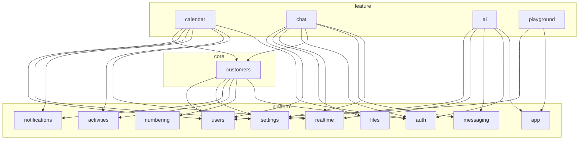

# Модулі, граф залежностей і реєстри фіч

Стан на **2026-10-06**. Джерело правди про граф — `modules.config.ts` у корені; перевірка —
`pnpm modules:check` (`scripts/modules-check.ts`). Цей документ — **єдина** опора для питання
«як тримати файли розвʼязаними»: що таке модуль, хто від кого залежить, як нижній модуль
показує фічу вище без імпорту, що лишається центральним і чому. Правило нового коду — §5 і §8.

## 1. Принцип

Скелет форкають під різні продукти: календар, чат чи AI-асистент можуть бути не потрібні, а
клієнти (`customers`) є майже завжди. Але **зручність видалення не диктує архітектуру**.
Доменна звʼязність нормальна — подія календаря справді належить клієнту, і сторінка клієнта
справді показує його події. Ціль інша: **кожна залежність задекларована, має напрямок і не
утворює циклу**. Тоді видалення фічі — це читання графа, а не археологія.

Модуль — це **домен, а не тека**: календар живе в `libs/contracts/src/calendar`,
`apps/api/src/calendar`, `libs/database/prisma/schema/calendar.prisma` і
`apps/web/src/features/calendar/`; усе це — модуль `calendar`. Усередині кожного застосунку
файли модуля зібрані в одну теку: бекенд — Nest-модуль (`apps/api/src/<модуль>/`), обидва
фронтенди — `src/features/<модуль>/` (`pages/`, `components/`, `stores/`, `realtime/`, `lib/`
усередині — за потребою, плюс `<модуль>.routes.tsx` і `<модуль>-sidebar.tsx`). Поза `features/`
лишається лише спільне без домену: `app-shell/`, `components/` (форми, секції), `lib/`, `api/`,
`i18n/` і composition roots (`router.tsx`, `slot-fills.ts`, `main.tsx`).

## 2. Рівні

| Рівень     | Модулі                                                                                                                                              | Хто від нього залежить           |
| ---------- | --------------------------------------------------------------------------------------------------------------------------------------------------- | -------------------------------- |
| `infra`    | `infra` — БД, UI-кит, i18n, помилки, конфіг                                                                                                         | усі, **без декларації**          |
| `platform` | `app`, `auth`, `account`, `users`, `settings`, `files`, `notifications`, `activities`, `realtime`, `messaging`, `numbering`, `tenants`, `dashboard` | `core`, `feature`, інші platform |
| `core`     | `customers`                                                                                                                                         | `feature`                        |
| `feature`  | `calendar`, `chat`, `ai`, `guide`, `playground`                                                                                                     | лише composition roots           |

Правила, які перевіряє `modules:check` ще до аналізу коду:

- **Ребро лише вниз або вбік.** `feature → core → platform → infra`. Ребро вгору в
  `dependsOn` — помилка конфігурації: такий звʼязок робиться слотом чи реєстром (§4).
- **Без циклів** — окрім циклів усередині `platform`. Платформа — ядро, яке ніхто не видаляє
  частинами, і там є історично взаємні звʼязки (`auth ↔ realtime`: скидання пароля рве сокети,
  а сокет автентифікується токеном; `notifications ↔ realtime`; `users ↔ account`). Цикл
  `customers ↔ calendar` чи `chat ↔ ai` — помилка.
- **Кожне ребро використане.** Задекларована залежність без жодного імпорту виводиться у звіті:
  граф описує код, а не наміри.

`dashboard` — platform, бо стартовий екран є в кожному форку; його віджети приходять від фіч.
`guide` і `playground` — демо-фічі UI-кіту, форк їх зазвичай прибирає першими.

## 3. Граф

Залежності `core` і `feature` (platform-внутрішні ребра — у `modules.config.ts`):



Що з цього випливає для форку:

- **Прибрати `calendar`, `chat` чи `ai`** — жоден модуль їх не імпортує; що лишилося звʼязаним
  без імпорту (рядки, Prisma, рядок у схемі bootstrap) — §6.
- **Прибрати `customers`** — тягне `calendar`. Ребро `calendar → customers` мʼяке: привʼязка
  події до клієнта необовʼязкова (`calendar_events.customer_id` nullable, `SetNull`), тож
  можна або прибрати календар, або відрізати від нього вибір клієнта.

## 4. Звʼязок угору — слоти, хуки й реєстри

Коли домен хоче показати фічу всередині модуля нижче (події на сторінці клієнта, агенда на
дашборді, AI-панель в оболонці) або виконати її крок у своєму сценарії (новий юзер вступає в
дефолтний канал чату, новий тенант отримує канал), нижній модуль **не імпортує** фічу. Він
оголошує точку розширення, а фіча реєструється в ній сама. Причина — не видалення, а
ацикличність: `customers` уже потрібен календарю, і зворотний імпорт зробив би їх одним модулем.

### 4.1. Фронтенд: слоти

`apps/web/src/lib/slots.tsx`. Слот оголошує той, хто його рендерить:
`defineSlot<Props>('customers.overview-cards')` у файлі свого модуля. Фіча експортує звичайний
компонент. Повʼязує їх лише composition root `apps/web/src/slot-fills.ts`
(`fillSlot(slot, id, Component)`), а `SlotsProvider` у `main.tsx` роздає внески;
`<SlotOutlet slot props />` малює їх на місці. Тип пропсів звіряється на `fillSlot`.

| Слот                    | Хто рендерить                                                  | Хто заповнює                                                    |
| ----------------------- | -------------------------------------------------------------- | --------------------------------------------------------------- |
| `shellHeaderActions`    | `app-shell.tsx` (хедер)                                        | `ai` — кнопка асистента                                         |
| `shellSidePanels`       | `app-shell.tsx` (права колонка)                                | `ai` — панель асистента                                         |
| `dashboardWidgets`      | `features/dashboard/pages/dashboard.tsx`                       | `guide` — вхід; `calendar` — агенда; `activities` — стрічка     |
| `customerOverviewCards` | `features/customers/pages/customer-overview.tsx`               | `calendar` — найближчі події                                    |

### 4.1.1. Фронтенд: навігація — розділи рейлу й пункти меню

Той самий принцип для навігації шела (`docs/frontend/app-shell.md` §2): **area** (розділ
рейлу) і **пункт меню** оголошує модуль-власник у `features/<модуль>/<модуль>.nav.ts`
(`defineArea`, `defineNavigation`), а пункт у чужому розділі імпортує його `Area` — звичайне
ребро вниз (`calendar → settings`). Збирає їх `import.meta.glob` у `apps/*/src/nav.ts`
(composition root, без списку фіч): додав файл — з'явився розділ чи пункт, прибрав теку —
зникли. Порядок — `order` у записі, знімок усіх меню — `apps/web/src/nav.test.ts`. Видимість
виводиться з `staticData.access` роуту (той самий предикат, що гейт). Механізм — `libs/ui/src/navigation`.

**Локальні меню сторінок** (вкладки картки клієнта) використовують той самий реєстр:
власник оголошує `defineMenu({ id })`, а модулі додають `menuItems` у своїх `*.nav.ts`.
Меню реєструється в `menus` власника. Це не `Area`: воно не додає пункт у рейл, не
володіє префіксом чи другою колонкою. `NavigationTabs` — спільний рендерер меню у вигляді
вкладок; сторінка передає `menu` та параметри сутності (`{ customerId }`). Порядок і
видимість працюють як у меню шела: `order`, потім `id`, доступ із `staticData.access`
маршруту та його батьків. Доступ перевіряється за шаблоном (`$customerId`), а посилання
будує роутер із фактичними параметрами. Активність — із URL, `match: 'exact'` для огляду,
найдовший префікс для решти; кінцевий `/` не змінює вкладку.

`customers.nav.ts` володіє `customerDetailMenu` і пунктами Overview / Contacts;
`calendar.nav.ts` імпортує цей токен (наявне ребро `calendar → customers`) й додає Events.
`customers` не імпортує календар. Компонентного слота для вкладок більше немає: внесок —
дані навігації, а не власний UI фічі. Маршрути й далі збирає `router.tsx`.

Слот — для **компонента** фічі в чужому екрані. Коли фіча лише постачає **дані** generic-
механізму (типи сповіщень, тексти, події сокета, маршрути) — потрібен не слот, а реєстр
визначень, який збирає composition root (§7).

### 4.2. Бекенд: реєстри, у які фіча пише з `onModuleInit`

Фіча імпортує модуль нижче (ребро вниз, як і належить) і реєструє свою дію; модуль нижче
виконує все зареєстроване, не знаючи хто це.

| Реєстр                                            | Що виконує                                                      | Хто реєструється                                        |
| ------------------------------------------------- | --------------------------------------------------------------- | ------------------------------------------------------- |
| `UserLifecycleHooks` (`users`)                    | хуки **в транзакції** створення юзера; кидок відкочує створення | `chat` — членство в дефолтному каналі                   |
| `TenantLifecycleHooks` (`tenants`, control plane) | хуки **в транзакції** створення тенанта                         | `chat` — дефолтний канал і членство адміна              |
| `BootstrapRegistry` (`settings`)                  | прапорці `features` і секції фіч у `GET /settings/bootstrap`    | `ai` — `features.ai`; `calendar` — секція `calendar`    |
| `SettingsService.updateSection` (`settings`)      | зберігання секції `Tenant.settings` JSON + журнал змін          | `ai`, `calendar` — `/settings/ai`, `/settings/calendar` |

Форму bootstrap-відповіді, якій потрібні типи секцій фіч, задає composition root контрактів
`libs/contracts/src/bootstrap.schema.ts` (ядро `SettingsBootstrapCoreSchema` + `calendar`);
відповідь проходить через нього `parse`-ом, тож секція, обіцяна схемою, але не
зареєстрована, — помилка, а не тихий `undefined` у SPA.

Хук у транзакції — для того, що є **частиною** сценарію (юзер поза дефолтним каналом не
існує як стан). Наслідок, який може статися потім і повторюватися — `publish(tx, подія)` з
підписником у worker, а не хук (`docs/backend-conventions.md` §5).

Коли фіча має писати таблиці в процесі, який її Nest-модуля не містить (control plane створює
тенант і мусить створити канал), логіка живе в `libs/shared/src/<модуль>/` як провізіонер із
`tx` першим аргументом: його кличуть і хук фічі, і сід, і сервіс tenant-api
(`libs/shared/src/chat/default-channel.ts`: `ensureDefaultChannel`, `joinDefaultChannel`).

## 5. Composition roots і правило «проводка / визначення»

Знати список модулів дозволено лише файлам, що **збирають** модулі докупи: `app.module.ts`,
`worker.module.ts`, `router.tsx`, `main.tsx`, `i18n/`, `nav.ts`,
barrel-и `libs/*/src/index.ts`, маніфест черг `messaging/topology.ts`, схеми й реєстри
контрактів (`bootstrap.schema.ts`, `notification-types.ts`, `activity-types.ts`,
`socket-events.ts`), наповнення слотів `apps/web/src/slot-fills.ts`, збирання навігації `apps/*/src/nav.ts`. Повний перелік —
`COMPOSITION_ROOTS` у `modules.config.ts`.

| Може — проводка                                                                                         | Не може — визначення фічі                                 |
| ------------------------------------------------------------------------------------------------------- | --------------------------------------------------------- |
| перелік модулів і посилання на їхні визначення                                                          | payload-схеми, контракти даних фічі                       |
| операційні налаштування проводки: retry / concurrency / cron черг, пороги лімітів, порядок пунктів меню | тексти, які бачить користувач                             |
| коментар «чому саме такі налаштування»                                                                  | бізнес-дефолти фічі, `if`/`switch` по її типах, рендеринг |

Кожен розширюваний механізм має три ролі:

| Роль           | Хто                                | Що тримає                                               |
| -------------- | ---------------------------------- | ------------------------------------------------------- |
| **Механізм**   | платформний модуль (notifications) | форму визначення, хелпер `define…`, рантайм, generic UI |
| **Визначення** | фіча (calendar)                    | свої типи, payload-схеми, тексти, дефолти               |
| **Збірка**     | composition root                   | перелік визначень фіч — рядок на фічу                   |

**Іменування.** Суфікс файлу визначень = механізм, який його читає, і збігається з функцією
`define…` у ньому: `calendar.notifications.ts` (`defineNotificationTypes`),
`calendar.activities.ts` (`defineActivityTypes`), `calendar.socket-events.ts`
(`defineSocketEvent`). Не `realtime`: слово «event» у репо зайняте тричі (`CalendarEvent`,
messaging, сокет), а `socket-events` одразу каже про транспорт.

**Як вирішувати, чи переносити файл у власника.** Чотири питання до кожного центрального файлу:

1. Що в ньому — визначення фічі чи проводка?
2. Чи є огляд «усе в одному місці» **свідомою цінністю** (налагодження, рев'ю безпеки, порядок
   меню)?
3. Скільки чужих файлів правитиме кожна нова фіча?
4. Фічу видалили, рядок лишився — **голосно** (компіляція / старт) чи **тихо** (мертві дані)?

Проводку лишаємо центральною — це маніфест, і його огляд цінний. Визначення, що потрапили в
центральний файл, переносимо до власника, а файл стає root-ом, який їх збирає.

## 6. Що перевіряється і що ні

`pnpm modules:check` будує TypeScript-програму для кожного застосунку й бібліотеки і
резолвить кожен іменований імпорт до файлу, де символ **оголошено**. Тому імпорт через barrel
(`import { CalendarEventSchema } from '@saas-skeleton/contracts'`) дає ребро до `calendar`, а не
до «contracts» — madge і dependency-cruiser тут бачать лише barrel. Файл без власника теж
виводиться: новий файл має потрапити в шаблон якогось модуля.

Режими: без прапорців — звіт, exit 0; `--strict` — exit 1 на порушення чи файл без власника
(так його запускає `pnpm lint`, а отже і CI `verify`); `--edges` — фактичний граф з кількістю
імпортів.

Чого скрипт **не бачить** (тримається на рев'ю й на §7):

- **Визначення не в тому модулі.** Якщо схему фічі оголосити прямо у файлі платформного
  модуля, імпорту немає — ребра теж. Для цього й існує §7: типи, схеми й тексти фіч живуть у
  фічі.
- **Рядкові звʼязки:** i18n-ключі (`t('calendar:…')`), типи сповіщень
  (`'calendar_event.invited'`), шляхи маршрутів рядком. Частину ловить
  `apps/web/src/i18n/registry-texts.test.ts` (тексти типів, оголошених у контрактах).
- **Згенерований orval-клієнт** — один файл на всі теги, належить `app`; хуки календаря з
  нього не атрибутуються календарю.
- **Prisma relations.** Prisma вимагає обидві сторони звʼязку, тож `Tenant`, `User` і
  `Customer` перелічують back-relations кожної фічі. Це **прийнятий виняток**: обійти його
  можна лише відмовою від relation, а `migrate diff` тоді пропонуватиме прибрати FK (той самий
  клас проблем, що зі згенерованими колонками, AGENTS.md п.17). Схема розрізана на файл на
  модуль (`libs/database/prisma/schema/<модуль>.prisma`), а back-relations фіч згруповані
  коментарем із назвою модуля. Після видалення файлу фічі `prisma validate` сам показує рядки,
  які треба прибрати (для календаря — сім: три в `tenant.prisma`, три в `users.prisma`, один у
  `customers.prisma`).
- Тести (`*.test.ts`, `*.spec.ts`, `test/`) пропущені: фікстури легітимно збирають кілька
  модулів.

## 7. Реєстри визначень фіч

### 7.1. Типи сповіщень і активностей

Механізми: `defineNotificationTypes` (`libs/contracts/src/notification/notification-definition.ts`)
і `defineActivityTypes` (`activity/activity-definition.ts`) + `mergeTypeGroups`.

- **Визначення** — у контрактах власника: `{user,auth,customer,calendar}/*.notifications.ts`,
  `{user,auth,customer,settings,calendar}/*.activities.ts`. Тип несе payload-схему, дефолти,
  категорію й адресу текстів (`texts: { ns, prefix }`, опційний `textVariant`).
- **Збірка** — `libs/contracts/src/notification-types.ts` і `activity-types.ts`:
  `NOTIFICATION_TYPES`, схеми, meta, `ACTIVITY_TYPES` виводяться з них, тож `NotificationType`
  лишається точним union-ом і `satisfies Record<NotificationType, …>` ловить забутий тип.
- **Тексти** — у неймспейсі модуля-власника (`calendar.json` → `notifications.*`, `activity.*`;
  `customers.json` → те саме). Тексти платформних типів (`user.*`, `auth.*`, `settings.*`,
  `email.*`, `system`, `unknown`) і самих центрів лишаються в спільних `notifications.json` /
  `activities.json`: розносити їх по `users.json` / `auth.json` означало б тягнути тексти
  інбокса в неймспейси екранів логіну без виграшу для форку. Переносяться лише тексти фіч
  рівнів `core` і `feature`. Тексти **екранів** фіч (налаштування календаря, AI) теж у їхніх
  неймспейсах (`calendar.json` / `ai.json` → `settings.*`); підписи пунктів меню лишаються біля
  меню (`layout.json`).
- **Рантайм** — `notification-message.tsx`, `activity-message.tsx`, `notification-preferences.tsx`
  читають визначення типу з реєстру контрактів; ні переліку типів, ні `if` по конкретному типу
  в них немає (спецвипадок — поле визначення). Помічник `apps/web/src/lib/payload-values.ts`
  generic. `registry-texts.test.ts` звіряє, що кожен тип має тексти за своєю адресою.

### 7.2. Події сокета

Механізм: `defineSocketEvent(name, schema)` (`libs/contracts/src/realtime/socket-event.ts`).

- **Визначення** — `calendar/calendar.socket-events.ts`, `ai/ai.socket-events.ts`,
  `chat/chat.socket-events.ts`; платформні
  (`presence.*`, `auth.*`, `realtime.resync-required`, `notification.*`) лишаються в `realtime/`.
- **Збірка** — root `libs/contracts/src/socket-events.ts`: `SERVER_SOCKET_EVENTS`,
  `REALTIME_EVENTS`, `ServerToClientEvents`. Перелік подій як огляд протоколу лишається.
- **Емітери generic**: `RealtimeEmitter.toUsers(tenantId, userIds, event, payload)` і
  `toUser`, `WorkerRealtimeEmitter.toUser`; методів «під фічу» в емітерах немає, виклики —
  у сервісах фічі.

Вхідний бік (client → server) влаштований так само, дзеркально:

- **Механізм** — `defineClientSocketEvent(name, payload, ackData)`
  (`libs/contracts/src/realtime/client-socket-event.ts`): схема payload-у, схема даних ack-а і
  закритий перелік кодів відмови.
- **Визначення** — у контрактах власника: `chat/chat.client-events.ts`. Збирання — root
  `socket-events.ts`: `CLIENT_SOCKET_EVENTS`, `CLIENT_EVENTS`, `ClientToServerEvents` (платформні
  події + зареєстровані). `auth.update.v1` лишається `@SubscribeMessage` гейтвея: він змінює
  `socket.data` і тримає таймери, це ядро протоколу, а не подія фічі.
- **Реєстрація** — фіча кличе `ClientEventRegistry.register(def, handler, { rateLimit? })` зі свого
  `onModuleInit` (`chat/chat.socket-handlers.ts`). Реєстр — у `realtime`, тож realtime не знає про
  фічу, а фіча лишається в межах свого модуля: перевірку доступу виконує її власна функція.
  Подробиці й гарантії (ліміт, валідація, tenant-контекст, ack) — docs/realtime.md.

### 7.3. Провізіонінг тенанта

Дефолтний канал чату при появі тенанта: провізіонер `libs/shared/src/chat/default-channel.ts`
(§4.2), хук `TenantLifecycleHooks` (`apps/platform-api/src/tenants/tenant-lifecycle.hooks.ts`),
реєстрація хука в модулі `apps/platform-api/src/chat/chat-provisioning.module.ts`. Control plane
`tenants` про чат не знає; сід і `DefaultChannelService` api кличуть той самий провізіонер.

### 7.4. Маршрути й вкладені лейаути

Маршрут = компонент; дочірній маршрут рендериться в `<Outlet/>` батька (той самий механізм, що
`<router-outlet>` в Angular). Маршрут без `component` прозорий — лише групує URL і тримає
`beforeLoad` / `staticData`. Сусіди замінюють одне одного, діти вкладаються. Іменованих outlet-ів
у TanStack Router немає: те, що сторінка кладе поза центральну область (хедер, права панель),
іде порталами — `PageHeaderSlot`, `ContextPanelPortal`.

Правило розкладки (обидва фронтенди):

1. **Маршрути модуля — у його теці**: `features/<модуль>/<модуль>.routes.tsx` — визначення
   (`createRoute`, `validateSearch`, `beforeLoad`, `staticData`, search-схеми й їхні типи, які
   сторінки імпортують звідси, а не з `router.tsx`). Оболонка (root, гейт сесії, 404) —
   `app-shell/app.routes.tsx`, гейти — `features/auth/auth.guards.ts`.
2. **Дочірній маршрут імпортує батьківський з модуля нижче** — це звичайне ребро вниз за графом.
   Маршрут фічі може висіти під чужим лейаутом: `settingsCalendarRoute` (календар) — під
   `settingsRoute` (settings); вкладка «Events» календаря — під карткою клієнта.
3. **Збирає дерево лише root `router.tsx`**: `addChildren` по всіх модулях — рядок на модуль.
   Модуль нижче не знає, хто до нього причепився: про вкладку фічі на його екрані він дізнається
   з реєстру навігації, а про маршрут — нічого.
4. Типи (`Link to`, `useParams({ from })`, `useSearch`) TanStack Router виводить із зібраного
   дерева; імпорт батьківського маршруту дає точний тип батька.

Приклад — картка клієнта (білінг буде за тим самим патерном, що вже працює для «Events»):

```
appRoute (AppShell)
└─ /workspace
   └─ customers/$customerId     CustomerDetailLayout: шапка + вкладки + <Outlet/>   ← customers
      ├─ /                      огляд                                             ← customers
      ├─ contacts               контакти                                          ← customers
      ├─ events                 події клієнта                                     ← calendar
      └─ billing                CustomerBilling + <Outlet/>                       ← billing
         └─ invoices/$invoiceId рахунок усередині картки клієнта                  ← billing
```

```tsx
// features/customers/customers.routes.tsx — модуль нижче, про фічі не знає
export const customerDetailRoute = createRoute({
  getParentRoute: () => workspaceRoute,
  path: 'customers/$customerId',
  component: CustomerDetailLayout, // шапка, <NavigationTabs menu={customerDetailMenu} params={{ customerId }}/>, <Outlet/>
});
// features/customers/customers.nav.ts (і menus: [customerDetailMenu] у default export)
export const customerDetailMenu = defineMenu({ id: 'customers.detail' });

// features/billing/billing.routes.tsx — фіча, ребро billing → customers
export const customerBillingRoute = createRoute({
  getParentRoute: () => customerDetailRoute,
  path: 'billing',
  component: CustomerBilling,
});

// router.tsx — composition root
customerDetailRoute.addChildren([
  customerOverviewRoute,
  customerContactsRoute,
  customerBillingRoute,
]);
// features/billing/billing.nav.ts — імпортує customerDetailMenu з customers.nav.ts
export default defineNavigation({
  menuItems: [{
    id: 'billing.customer', menu: customerDetailMenu, order: 40,
    label: 'billing:customer.tab',
    link: linkOptions({
      from: '/workspace/customers/$customerId',
      to: '/workspace/customers/$customerId/billing', params: true,
    }),
  }],
});
```

Прибрати фічу з форку = прибрати її маршрути з `router.tsx` і теку з `*.nav.ts`
(та внески компонентів із `slot-fills.ts`, якщо є); вкладка зникає, URL
перестає існувати, а забуте типізоване посилання ламає компіляцію.

### 7.5. Свідомо лишаємо центральними

| Що                                                             | Чому                                                                                                                                                                                                                       |
| -------------------------------------------------------------- | -------------------------------------------------------------------------------------------------------------------------------------------------------------------------------------------------------------------------- |
| `libs/shared/src/messaging/topology.ts`                        | єдиний маніфест черг: усі споживачі, налаштування й cron в одному місці; продюсер мусить знати споживачів у момент `publish`; розсинхрон валить воркер на старті. Визначення повідомлень уже у власників (`*.messages.ts`) |
| ліміти запитів (`throttle.config.ts`, `RATE_LIMITS`)           | рев'ю безпеки бачить усі пороги разом; AI — рядок конфігу, не логіка                                                                                                                                                       |
| `entity-routes.ts`                                             | мапа сутність → шлях: типізована, забута фіча ламає компіляцію                                                                                                                                                             |
| нумерація (`NUMBER_SERIES_NAMES = ['customer']`)               | закрита таблиця конфігу з одним рядком; повернутися, коли серій стане 3+                                                                                                                                                   |
| сід як один скрипт                                             | розбивати нема сенсу; чат провізіонить себе сам через спільний провізіонер                                                                                                                                                 |
| `aiAllowed` на тенанті (control plane)                         | платформне керування фічею (AI-5); коли зʼявиться друга фіча з дозволом на тенант — загальні entitlements «тенант × фіча»                                                                                                  |
| Prisma back-relations у `Tenant` / `User` / `Customer`         | Prisma вимагає обидві сторони звʼязку (§6)                                                                                                                                                                                 |
| `User.timeZone`                                                | загальна властивість людини (формат дат, листи), не календарні дані                                                                                                                                                        |
| `app.module.ts`, `worker.module.ts`, barrel-и, `i18n/index.ts` | чисті переліки — роль root-а                                                                                                                                                                                               |
| `guide`, `playground`                                          | демо-фічі верхнього рівня: показувати все — їхня робота                                                                                                                                                                    |

## 8. Новий модуль

1. Додай запис у `MODULES` (`modules.config.ts`): рівень, одне речення про модуль, шаблони
   шляхів, `dependsOn`.
2. `pnpm modules:check` — нуль порушень і нуль файлів без власника.
3. Якщо модулю треба показатися в модулі нижче — слот чи реєстр (§4), не імпорт.
4. Типи сповіщень, активностей, події сокета, тексти — у файлах модуля за суфіксами §5;
   у root-и додається один рядок (§7).
5. Фронтенд: `features/<модуль>/` із `<модуль>.routes.tsx`; у `router.tsx` — рядок
   `addChildren`, у `slot-fills.ts` — внески в слоти.
6. Таблиці — окремий файл `libs/database/prisma/schema/<модуль>.prisma`; back-relations у
   `Tenant` / `User` — у групі з коментарем-назвою модуля. Міграції — одна лінійна історія в
   `prisma/migrations/`.
7. Фіча нижче за чужий лейаут (вкладка картки, секція налаштувань) — маршрут імпортує батька
   (§7.4), а лейаут оголошує слот; лейаут про фічу не знає.
