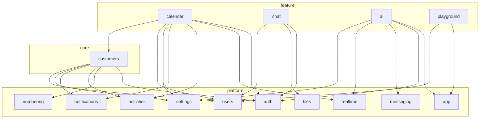

# Модулі та граф залежностей

Стан на **2026-10-05**. Джерело правди — `modules.config.ts` у корені; перевірка —
`pnpm modules:check` (`scripts/modules-check.ts`). Цей документ пояснює, **чому** граф такий.

## 1. Принцип

Скелет форкають під різні продукти: календар, чат чи AI-асистент можуть бути не потрібні, а
клієнти (`customers`) є майже завжди. Але **зручність видалення не диктує архітектуру**.
Доменна звʼязність нормальна — подія календаря справді належить клієнту, і сторінка клієнта
справді показує його події. Ціль інша: **кожна залежність задекларована, має напрямок і не
утворює циклу**. Тоді видалення фічі — це читання графа, а не археологія.

Модуль — це **домен, а не тека**. Календар живе в `libs/contracts/src/calendar`,
`apps/api/src/calendar`, `apps/web/src/components/calendar`, `apps/web/src/pages/calendar.tsx`
і ще кількох місцях; усі вони — модуль `calendar`. Фізичне розташування файлів (окремі пакети
`features/x` тощо) свідомо не змінювали: граф працює з поточною структурою, а пакетування фіч
вимагало б винести в `libs` інфраструктуру застосунків (HTTP-клієнт, form-обгортки, auth-
декоратори) — ціна без вигоди, поки фічі не ставляться як плагіни.

## 2. Рівні

| Рівень     | Модулі                                                                                                                                              | Хто від нього залежить           |
| ---------- | --------------------------------------------------------------------------------------------------------------------------------------------------- | -------------------------------- |
| `infra`    | `infra` — БД, UI-кит, i18n, помилки, конфіг                                                                                                         | усі, **без декларації**          |
| `platform` | `app`, `auth`, `account`, `users`, `settings`, `files`, `notifications`, `activities`, `realtime`, `messaging`, `numbering`, `tenants`, `dashboard` | `core`, `feature`, інші platform |
| `core`     | `customers`                                                                                                                                         | `feature`                        |
| `feature`  | `calendar`, `chat`, `ai`, `guide`, `playground`                                                                                                     | лише composition roots           |

Правила, які перевіряє `modules:check` ще до аналізу коду:

- **Ребро лише вниз або вбік.** `feature → core → platform → infra`. Ребро вгору в
  `dependsOn` — помилка конфігурації: такий звʼязок робиться слотом (§4).
- **Без циклів** — окрім циклів усередині `platform`. Платформа — ядро, яке ніхто не видаляє
  частинами, і там є історично взаємні звʼязки (`auth ↔ realtime`: скидання пароля рве сокети,
  а сокет автентифікується токеном; `notifications ↔ realtime`; `users ↔ account`). Цикл
  `customers ↔ calendar` чи `chat ↔ ai` — помилка.
- **Кожне ребро використане.** Задекларована залежність без жодного імпорту виводиться у звіті:
  граф описує код, а не наміри.

`dashboard` — platform, бо стартовий екран є в кожному форку; його віджети приходять від фіч.
`guide` і `playground` — демо-фічі UI-кіту, форк їх зазвичай прибирає першими.

## 3. Граф

Залежності `core` і `feature` (platform-внутрішні ребра — у `modules.config.ts`):

Що з цього випливає для форку:

- **Прибрати `calendar`, `chat` чи `ai`** — жоден модуль їх не імпортує; що лишилося звʼязаним
  без імпорту (рядки, Prisma, рядок у схемі bootstrap) — §7.
- **Прибрати `customers`** — тягне `calendar`. Ребро `calendar → customers` мʼяке: прив'язка
  події до клієнта необовʼязкова (`calendar_events.customer_id` nullable, `SetNull`), тож
  можна або прибрати календар, або відрізати від нього вибір клієнта. Якщо таких «мостів»
  стане багато, відомий патерн — bridge-модуль, що існує лише коли є обидві сторони (Odoo
  `sale_stock`). Поки що передчасно.

## 4. Звʼязок угору — слоти й реєстри

Коли домен хоче показати фічу всередині модуля нижче (події на сторінці клієнта, агенда на
дашборді, AI-панель в оболонці) або виконати її крок у своєму сценарії (новий юзер вступає в
дефолтний канал чату), нижній модуль **не імпортує** фічу. Він оголошує точку розширення, а
фіча реєструється в ній сама. Причина — не видалення, а ацикличність: `customers` уже
потрібен календарю, і зворотний імпорт зробив би їх одним модулем.

**Фронтенд — слоти** (`apps/web/src/lib/slots.tsx`). Слот оголошує той, хто його рендерить:
`defineSlot<Props>('customers.overview-cards')` у файлі свого модуля. Фіча експортує звичайний
компонент. Повʼязує їх лише composition root `apps/web/src/slot-fills.ts` (`fillSlot(slot, id,
Component)`), а `SlotsProvider` у `main.tsx` роздає внески; `<SlotOutlet slot props />` малює
їх на місці. Тип пропсів звіряється на `fillSlot`. Наявні слоти:

| Слот                    | Хто рендерить                   | Хто заповнює                 |
| ----------------------- | ------------------------------- | ---------------------------- |
| `shellHeaderActions`    | `app-shell.tsx` (хедер)         | `ai` — кнопка асистента      |
| `shellSidePanels`       | `app-shell.tsx` (права колонка) | `ai` — панель асистента      |
| `dashboardWidgets`      | `pages/dashboard.tsx`           | `calendar` — агенда          |
| `customerOverviewCards` | `pages/customer-detail.tsx`     | `calendar` — найближчі події |

**Бекенд — реєстри, у які фіча пише з `onModuleInit`.** Фіча імпортує модуль нижче (ребро
вниз, як і належить) і реєструє свою дію; модуль нижче виконує все зареєстроване, не знаючи
хто це:

| Реєстр                                       | Що виконує                                                      | Хто реєструється                                        |
| -------------------------------------------- | --------------------------------------------------------------- | ------------------------------------------------------- |
| `UserLifecycleHooks` (`users`)               | хуки **в транзакції** створення юзера; кидок відкочує створення | `chat` — членство в дефолтному каналі                   |
| `BootstrapRegistry` (`settings`)             | прапорці `features` і секції фіч у `GET /settings/bootstrap`    | `ai` — `features.ai`; `calendar` — секція `calendar`    |
| `SettingsService.updateSection` (`settings`) | зберігання секції `Tenant.settings` JSON + журнал змін          | `ai`, `calendar` — `/settings/ai`, `/settings/calendar` |

Форму bootstrap-відповіді, якій потрібні типи секцій фіч, задає composition root контрактів
`libs/contracts/src/bootstrap.schema.ts` (ядро settings `SettingsBootstrapCoreSchema` +
`calendar`); відповідь проходить через неї `parse`-ом, тож секція, обіцяна схемою, але не
зареєстрована, — помилка, а не тихий `undefined` у SPA.

Хук у транзакції — для того, що є **частиною** сценарію (юзер поза дефолтним каналом не
існує як стан). Наслідок, який може статися потім і повторюватися — `publish(tx, подія)` з
підписником у worker, а не хук (docs/backend-conventions.md §5).

Слот — для **компонента** фічі в чужому екрані. Коли фіча лише постачає **дані** generic-
механізму (типи сповіщень, тексти, маршрути), потрібен не слот, а реєстр визначень, який
збирає composition root (`docs/module-registries.md` §1).

## 5. Composition roots і маніфести

Знати список модулів дозволено лише файлам, що **збирають** модулі докупи: `app.module.ts`,
`worker.module.ts`, `router.tsx`, `main.tsx`, `i18n/`, `app-shell/areas.tsx` і `paths.ts`,
barrel-и `libs/*/src/index.ts`, маніфест черг `messaging/topology.ts`, схема bootstrap
`libs/contracts/src/bootstrap.schema.ts`, наповнення слотів `apps/web/src/slot-fills.ts`. Повний
перелік — `COMPOSITION_ROOTS` у `modules.config.ts`.

Що root **може** тримати, а що **ні**:

| Може — проводка                                                                                         | Не може — визначення фічі                                 |
| ------------------------------------------------------------------------------------------------------- | --------------------------------------------------------- |
| перелік модулів і посилання на їхні визначення                                                          | payload-схеми, контракти даних фічі                       |
| операційні налаштування проводки: retry / concurrency / cron черг, пороги лімітів, порядок пунктів меню | тексти, які бачить користувач                             |
| коментар «чому саме такі налаштування»                                                                  | бізнес-дефолти фічі, `if`/`switch` по її типах, рендеринг |

Тому частина центральних файлів лишається центральною **свідомо**: їхня цінність — огляд усього
в одному місці. `topology.ts` — єдиний маніфест черг (споживачі потрібні продюсеру в момент
`publish`, розсинхрон валить воркер на старті); ліміти запитів (рев'ю безпеки бачить усі пороги
разом); меню й `entity-routes.ts` (порядок — рішення UX, шляхи типізовані, тож забута фіча ламає
компіляцію). Переносимо лише визначення фіч, які в них опинилися. Повний розбір —
`docs/module-registries.md`.

## 6. Що перевіряється і що ні

`pnpm modules:check` будує TypeScript-програму для кожного застосунку й бібліотеки і
резолвить кожен іменований імпорт до файлу, де символ **оголошено**. Тому імпорт через barrel
(`import { CalendarEventSchema } from '@saas-skeleton/contracts'`) дає ребро до `calendar`, а не
до «contracts» — madge і dependency-cruiser тут бачать лише barrel. Файл без власника теж
виводиться: новий файл має потрапити в шаблон якогось модуля.

Режими: без прапорців — звіт, exit 0; `--strict` — exit 1 на порушення чи файл без власника
(так його запускає `pnpm lint`); `--edges` — фактичний граф з кількістю імпортів.

Чого скрипт **не бачить** (тримається на рев'ю):

- **Визначення не в тому модулі.** Якщо схему фічі оголосити прямо у файлі платформного
  модуля (так колись жили секції налаштувань, типи сповіщень і події сокета календаря),
  імпорту немає — ребра теж. Такі місця шукає аудит `docs/module-registries.md`.
- **Рядкові звʼязки:** i18n-ключі (`t('calendar:…')`), типи нотифікацій
  (`'calendar_event.invited'`), шляхи маршрутів рядком.
- **Згенерований orval-клієнт** — один файл на всі теги, належить `app`; хуки календаря з
  нього не атрибутуються календарю.
- **Prisma relations.** Prisma вимагає обидві сторони звʼязку, тож `Tenant` і `User`
  перелічують back-relations кожної фічі. Це **прийнятий виняток**: обійти його можна лише
  відмовою від relation, а `migrate diff` тоді, ймовірно, пропонуватиме прибрати FK (той
  самий клас проблем, що зі згенерованими колонками, AGENTS.md п.17). Схема розрізана на файл
  на модуль (`libs/database/prisma/schema/<модуль>.prisma`), а back-relations фіч у `Tenant`,
  `User` і `Customer` згруповані коментарем із назвою модуля. Після видалення файлу фічі
  `prisma validate` сам показує рядки, які треба прибрати (для календаря — сім: три в
  `tenant.prisma`, три в `users.prisma`, один у `customers.prisma`).
- Тести (`*.test.ts`, `*.spec.ts`, `test/`) пропущені: фікстури легітимно збирають кілька
  модулів.

## 7. Відомі порушення (2026-10-05)

`pnpm modules:check` — **0 порушень**. Усі сім ребер, знайдених першим прогоном, закрито:

| Було                                                     | Як закрито                                                                                                                                                                                                                         |
| -------------------------------------------------------- | ---------------------------------------------------------------------------------------------------------------------------------------------------------------------------------------------------------------------------------- |
| `users → chat`                                           | `UserLifecycleHooks`: chat реєструє членство в дефолтному каналі, users його не імпортує                                                                                                                                           |
| `settings → ai`                                          | секція `ai` переїхала в модуль `ai` (контракт, сервіс, `AiSettingsController`), прапорець — `BootstrapRegistry`                                                                                                                    |
| `customers → calendar`                                   | слот `customerOverviewCards`                                                                                                                                                                                                       |
| `dashboard → calendar`                                   | агенда переїхала в `calendar` (`dashboard-agenda-widget.tsx`), слот `dashboardWidgets`                                                                                                                                             |
| `app → ai`                                               | слоти `shellHeaderActions` / `shellSidePanels`                                                                                                                                                                                     |
| `auth → tenants`, `app → tenants`                        | `platform.schema.ts` розділено: `platform-auth.schema.ts` (auth) і `tenant.schema.ts`                                                                                                                                              |
| `settings` знає `calendar` (невидиме)                    | секція переїхала в `calendar` (контракт, `CalendarSettingsService`, `CalendarSettingsController`); bootstrap-секцію календар реєструє в `BootstrapRegistry`                                                                        |
| `notifications`, `activities` знають фічі (невидиме)     | R1: типи, payload-схеми, дефолти й тексти — у контрактах і неймспейсах власників (`*.notifications.ts`, `*.activities.ts`), root-и `notification-types.ts` / `activity-types.ts`; `KNOWN_TYPES` прибрано; `registry-texts.test.ts` |
| `realtime` знає `calendar` і `ai` (невидиме)             | R2: схеми подій — у `calendar.socket-events.ts` / `ai.socket-events.ts`, root `socket-events.ts` збирає `REALTIME_EVENTS` і `ServerToClientEvents`; емітери generic (`toUsers` / `toUser`)                                         |
| `tenants` (control plane) пише таблиці `chat` (невидиме) | R6: провізіонер `libs/shared/src/chat/default-channel.ts`, хук `TenantLifecycleHooks`, модуль `apps/platform-api/src/chat/`; сід кличе той самий провізіонер                                                                       |

Лишилися звʼязки, яких скрипт **не бачить** (§6): спільні реєстри нижчих модулів, у які
фічі дописують свої типи сповіщень і активностей, події realtime, маршрути й навігацію,
тексти, серії нумерації, провізіонінг тенанта, ліміти, сід і топологію черг. Повний аудит,
правило «механізм / визначення / збірка» і порядок робіт — **`docs/module-registries.md`**.

`modules:check --strict` входить у `pnpm lint` (і в CI `verify`): нове **видиме** порушення
зупиняє збірку. Таблиця вище — робота, яку тримає рев'ю, не лінт.

## 8. Новий модуль

1. Додай запис у `MODULES` (`modules.config.ts`): рівень, одне речення про модуль, шаблони
   шляхів, `dependsOn`.
2. `pnpm modules:check` — нуль порушень і нуль файлів без власника.
3. Якщо модулю треба показатися в модулі нижче — слот (§4), не імпорт.
4. Таблиці модуля — окремий файл `libs/database/prisma/schema/<модуль>.prisma`; back-relations у
   `Tenant` / `User` — у групі з коментарем-назвою модуля. Міграції — як і раніше, одна лінійна
   історія в `prisma/migrations/`.
